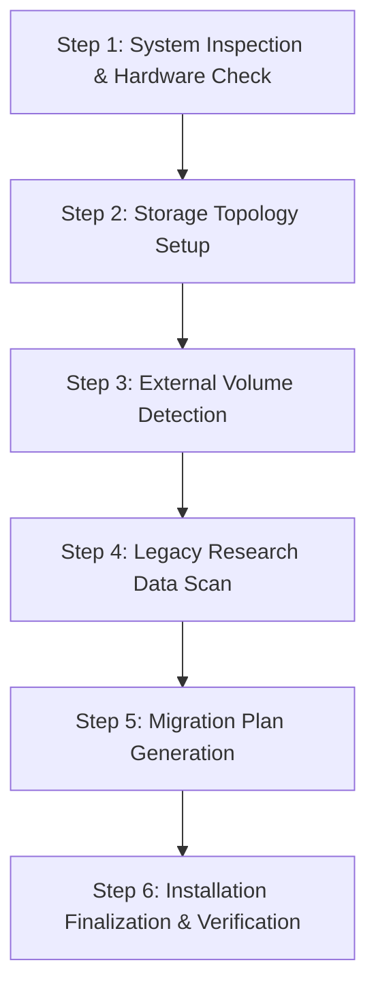

# PERCIVAL — First-Launch & Installation Setup Wizard Guide

**Target Version:** PERCIVAL v5.25  
**Platform:** macOS (Apple Silicon M1/M2/M3/M4 & Intel x86_64)  
**Module:** `cSS_pipeline_v4.13/unified_engine/uengine/wizard.py`  

---

## 1. Overview & Automated First-Launch Behavior

When PERCIVAL is launched on a fresh macOS installation or when `app_data/wizard_state.json` is absent or incomplete, the application automatically presents the **First-Launch Installation & Configuration Wizard**.

The wizard guides the clinical researcher through a structured 6-step initialization workflow designed to inspect prerequisites, establish local SSD and external storage topologies, detect existing research datasets, generate a migration plan, and verify full operational readiness.

---

## 2. The 6-Step Installation Flow



### Step 1: System Inspection & Prerequisite Validation
- **Hardware Architecture:** Validates Darwin kernel, CPU core count, and architecture (`arm64` Apple Silicon vs `x86_64` Intel).
- **RAM Capacity:** Determines physical system memory. Recommends pipeline concurrency:
  - `< 16 GB`: 1 study at a time
  - `16 - 32 GB`: 2 concurrent studies
  - `≥ 32 GB`: 4 concurrent studies
- **Mac SSD Headroom:** Validates root disk capacity. Displays warning if available space is below `50 GB`; blocks processing if below `5 GB`.
- **FreeSurfer Verification:** Validates `$FREESURFER_HOME`, license file validity (`license.txt`), `recon-all`, and `mri_synthseg` executables.
- **Python & Binary Dependencies:** Validates `dcm2niix`, `nibabel`, `scipy`, `sklearn`, `torch`, `pandas`, and `numpy`.

### Step 2: Storage Topology & Workspace Configuration
- **Primary Local Workspace:** User selects fast local Mac SSD directory (default: `~/percival_workspace` or repository base) for active compute, FreeSurfer processing, and neural network inference.
- **External Data Vault Mount:** User specifies target external storage path (e.g. `/Volumes/PERCIVAL_VAULT`).
- **Backup & Archive Directory:** User specifies independent secondary backup location.

### Step 3: External Volume Detection & Volume UUID Binding
- Scans `/Volumes/*` using macOS `diskutil info`.
- Identifies volume name, filesystem format (APFS, Mac OS Extended / HFS+, ExFAT), and persistent **Volume UUID**.
- Verifies read/write permissions.
- **No Password Requirement:** External drive mounts directly without application-level password hurdles.

### Step 4: Legacy Research Data Discovery Scan
- Strictly read-only scan of user's research paths for historical cSS / Percival datasets (`*.nii`, `*_candidates.csv`, `*_calls_*.csv`, `pensieve.db`).
- Depth-limited and protected against macOS TCC permission traps.

### Step 5: Migration Plan Generation
- Generates a categorized migration plan:
  - **Recent / In-Progress:** Staged on Mac SSD.
  - **Historical / Raw Archives:** Designated for external Data Vault.
  - **Candidate Annotations:** Prepared for ingestion into PENSIEVE memory.
  - Computes estimated Mac SSD space that will be reclaimed.

### Step 6: Installation Verification & State Persistence
- Verifies writability of all application directories.
- Writes default `settings.json` with **optional application lock DISABLED by default**.
- Writes persistent state to `app_data/wizard_state.json` allowing resumption if interrupted.

---

## 3. Resumption & Re-Running the Wizard

- **State File:** `app_data/wizard_state.json` tracks each completed step and intermediate configurations.
- **Interruption Recovery:** If the app is closed during step 3, re-launching immediately resumes at step 3.
- **Resetting the Wizard:** To re-run the setup wizard from scratch at any time, execute:
  ```bash
  python -c "from uengine.wizard import SetupWizard; SetupWizard('.').reset()"
  ```
  Or click **Reset Setup Wizard** in **Settings › System Diagnostics**.
