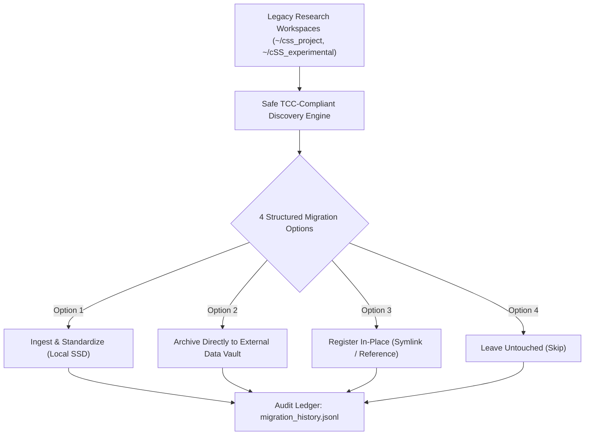

# PERCIVAL — Legacy Research Data Migration Guide

**Target Version:** PERCIVAL v5.25  
**Platform:** macOS (Darwin arm64 / x86_64)  
**Module:** `cSS_pipeline_v4.13/unified_engine/uengine/legacy_migration.py`  

---

## 1. Executive Summary & Non-Destructive Principles

Over years of neuroimaging research, laboratory workstations accumulate multiple generations of experimental pipeline outputs, ad-hoc directory layouts, FreeSurfer subjects folders, and raw NIfTI scans. On the target host workstation, legacy research workspaces (`~/css_project`, `~/cSS_experimental`, `~/Percival_project`) occupy over **38.2 GB** of internal storage, often formatted under older file naming conventions without unified provenance ledgers.

The PERCIVAL **Legacy Migration Engine** provides an automated, non-destructive bridge that detects, classifies, and migrates historical research assets into the modern v5.25 architecture.



---

## 2. Non-Destructive Safety Guarantees

> [!CAUTION]
> **Strict Non-Destructive Policy:**  
> The migration engine strictly enforces read-only access to source legacy files during discovery and migration. **Original legacy files are never deleted, renamed, or modified during migration.** Every migration operation is preceded by a dry-run plan and logged transactionally.

1. **Dry-Run Pre-Verification:**  
   Before moving or copying any files, PERCIVAL calculates required destination space, checks available disk quota, and verifies file readability.
2. **Cryptographic Checksum Verification:**  
   Every migrated scan is checksummed using SHA-256 before and after transfer. If a hash mismatch occurs, the transfer is rolled back immediately.
3. **Audit Trail Logging:**  
   Every migration event is recorded permanently in `app_data/migration_history.jsonl` with timestamps, source paths, destination paths, file sizes, and verification hashes.
4. **macOS TCC Permission Safety:**  
   The scanner limits search depth (`max_depth = 4`) and excludes protected operating system directories (`~/Library`, `~/Desktop`, `~/Documents`) unless explicitly targeted by the user, preventing macOS Transparency, Consent, and Control (TCC) security hangs.

---

## 3. The 4 Structured Migration Options

Researchers can choose between four distinct migration pathways depending on their immediate research goals and available hardware storage:

| Option | Name | Strategy | Impact on Host SSD | Best Used When |
| :---: | :--- | :--- | :--- | :--- |
| **1** | **Ingest & Standardize** | Copies legacy studies into `percival_workspace/studies/<ID>`, normalizes naming conventions, and registers metadata in Pensieve. | Uses local SSD space (~1.5–2 GB per study). | Actively analyzing legacy cohorts on local workstation. |
| **2** | **Direct to Data Vault** | Transfers legacy studies directly to the external Data Vault (`/Volumes/.../PERCIVAL_VAULT`), bypassing local SSD. | **Zero local SSD impact; saves local space.** | **Recommended when host Mac SSD is in Emergency/Critical tier (< 50 GB free).** |
| **3** | **Register In-Place** | Generates symbolic links and registers file references in Pensieve without copying physical data. | Negligible SSD impact (< 1 MB per study). | Preserving exact historical directory structures for legacy script compatibility. |
| **4** | **Leave Untouched** | Records the existence and location of legacy studies in the inventory catalog without moving or modifying anything. | No SSD impact. | Archival inspection or when historical runs should remain completely quarantined. |

---

## 4. Step-by-Step Migration Walkthrough

### Step 1: Automated Discovery Scan
In the PERCIVAL GUI under **Data Vault & Storage > Legacy Migration**, click **Scan for Legacy Studies**, or run via Python API:

```python
from uengine.legacy_migration import LegacyMigrationEngine

migrator = LegacyMigrationEngine(
    search_roots=[
        "~/css_project",
        "~/cSS_experimental",
        "~/Percival_project"
    ],
    target_workspace="~/percival_workspace"
)

# Run non-destructive discovery
discovered_studies = migrator.discover()
print(f"Found {len(discovered_studies)} legacy studies.")
```

### Step 2: Review Discovered Inventory
The scanner outputs a structured breakdown of discovered assets:
- **Study Identifier:** Detected subject ID (e.g., `SUBJ_042`).
- **Detected Modalities:** Identifies T1w MPRAGE, T2* GRE, SWI, FLAIR, and FreeSurfer segmentation folders (`mri/`, `surf/`).
- **Legacy Path & Size:** Exact path on disk and total byte size.
- **Data Integrity Score:** Validates whether NIfTI headers can be parsed and gzip streams are intact.

### Step 3: Select Migration Option & Execute Dry-Run
Choose a migration mode (e.g., `DIRECT_VAULT` to preserve host SSD capacity):

```python
# Generate Dry-Run Plan
plan = migrator.generate_plan(
    studies=discovered_studies,
    option="DIRECT_VAULT",
    vault_path="/Volumes/RESEARCH_VAULT/PERCIVAL_VAULT"
)

print(f"Total Transfer Size: {plan.total_size_gb:.2f} GB")
print(f"Destination Headroom Sufficient: {plan.space_verified}")
```

### Step 4: Execute Migration
Once confirmed, the migration engine processes studies sequentially with real-time progress bars:
1. File copy to destination using 64 KB buffered I/O.
2. SHA-256 calculation and double-check against source.
3. Registration of study in the local Pensieve SQLite database.
4. Logging entry into `migration_history.jsonl`.

---

## 5. Migration History & Audit Ledger

All operations are permanently logged to `app_data/migration_history.jsonl`. Each entry contains:

```json
{
  "timestamp": "2026-11-22T21:15:30.142Z",
  "study_id": "SUBJ_042_BL",
  "migration_option": "DIRECT_VAULT",
  "source_path": "/Users/tarabeah.selim/css_project/data/SUBJ_042",
  "destination_path": "/Volumes/RESEARCH_VAULT/PERCIVAL_VAULT/studies/SUBJ_042_BL",
  "file_count": 14,
  "total_bytes": 1845129420,
  "source_sha256": "8f3b...19a2",
  "destination_sha256": "8f3b...19a2",
  "status": "COMPLETED",
  "verification": "PASS"
}
```

This permanent audit trail ensures that data provenance is unbroken, satisfying medical device software compliance and clinical research traceability standards.
