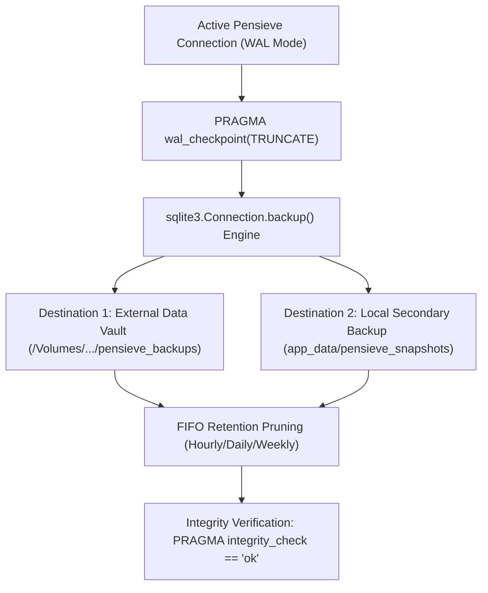
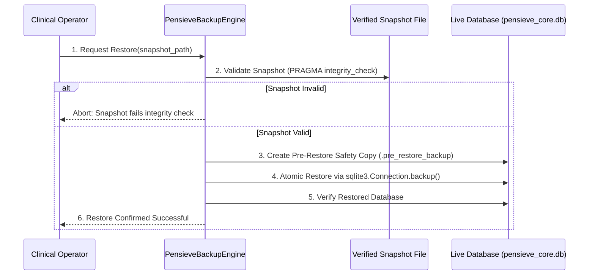

# PERCIVAL — Pensieve Core Memory Protection & Backup Guide

**Target Version:** PERCIVAL v5.25  
**Platform:** macOS (Darwin arm64 / x86_64)  
**Module:** `cSS_pipeline_v4.13/unified_engine/uengine/pensieve_backup.py`  

---

## 1. Executive Summary & Pensieve Architecture

The **Pensieve** is PERCIVAL's centralized cognitive database and longitudinal provenance engine (`pensieve_core.db`). It stores:
- De-identified patient cohorts and longitudinal study timelines.
- Exact acquisition parameters, slice geometries, and coil configurations.
- Biomarker outputs (cerebral superficial siderosis scores, Lumos probability distributions, Nox epistemic uncertainty metrics).
- Shadow ML model evaluation logs, challenger tournament brackets, and clinical governance audit trails.

Because neuroimaging clinical analyses and continuous learning loops write transactionally to the Pensieve during pipeline execution, ensuring database resilience against sudden power loss, drive disconnects, operating system panics, and disk corruption is a paramount architectural requirement.



---

## 2. Why Naive File Copying Fails in SQLite WAL Mode

Many software packages attempt to back up SQLite databases using simple filesystem copy commands (e.g., `shutil.copy()`, `cp`, or `rsync`). In high-performance applications operating under SQLite **Write-Ahead Logging (WAL)** mode, this approach causes **catastrophic database corruption**:

1. **Split-Transaction Reads:** If a writer process commits dirty pages to `pensieve_core.db-wal` while `cp` is mid-way through reading the main database file, the copied file contains a torn, inconsistent snapshot of database b-trees.
2. **Missing Shared Memory State:** The accompanying `pensieve_core.db-shm` file contains transient index states that cannot be restored simply by copying files.
3. **Corrupted Replay on Restore:** Restoring a file copied via filesystem copy often produces:
   `sqlite3.DatabaseError: database disk image is malformed`.

---

## 3. Zero-Corruption Native Backup Architecture

To guarantee 100% mathematical consistency and zero corruption, PERCIVAL's backup engine (`PensieveBackupEngine`) executes a rigorous 4-step atomic backup protocol:

### Step 1: WAL Checkpoint Flush
Before initiating the backup, the engine executes:
```sql
PRAGMA wal_checkpoint(TRUNCATE);
```
This forces all active transactions and uncommitted pages from the `-wal` file into the primary database file and truncates the WAL file to zero bytes.

### Step 2: Native SQLite Online Backup API
PERCIVAL utilizes the native C-level `sqlite3_backup_*` interface exposed through Python's `sqlite3.Connection.backup()`:
```python
# Atomic, zero-corruption online page replication
dest_conn = sqlite3.connect(snapshot_path)
with dest_conn:
    live_conn.backup(dest_conn, pages=100, sleep=0.01)
dest_conn.close()
```
The `backup()` method coordinates with the SQLite lock manager, ensuring that any concurrent queries can continue safely while guaranteeing that the destination database file receives a bit-exact, fully consistent snapshot.

### Step 3: Post-Snapshot Integrity Verification
Immediately upon completing the backup, the backup connection executes:
```sql
PRAGMA integrity_check;
PRAGMA foreign_key_check;
```
If the result is anything other than `ok`, the snapshot is marked corrupted, quarantined, and an immediate diagnostic warning is emitted.

---

## 4. Dual-Destination Snapshot Rotation

To protect against physical hardware loss or external volume unmounts, snapshots are automatically replicated to two independent locations:

1. **Primary Archival Destination (External Data Vault):**  
   `/Volumes/<VAULT_NAME>/PERCIVAL_VAULT/pensieve_backups/`  
   Guarantees that your complete clinical intelligence ledger is safe even in the event of total Mac workstation SSD failure.
2. **Secondary Local Destination (Internal SSD):**  
   `percival_workspace/app_data/pensieve_snapshots/`  
   Guarantees fast offline restore capability when working in the field without the external vault attached.

### Retention & Pruning Scheme
To prevent unbounded disk consumption, snapshots are managed under a strict First-In-First-Out (FIFO) retention rotation:
- **Last 10 Hourly Snapshots:** High-frequency checkpoints during active analysis batches.
- **Last 7 Daily Snapshots:** Retained for day-to-day auditability.
- **Last 4 Weekly Snapshots:** Long-term archival recovery points.

Older snapshots exceeding these thresholds are automatically and safely purged.

---

## 5. Verified Disaster Recovery & Restore Procedure

In the rare event of database corruption or hardware migration, PERCIVAL provides a safe, two-phase restore mechanism:



### Manual Disaster Recovery via Python API
```python
from uengine.pensieve_backup import PensieveBackupEngine

engine = PensieveBackupEngine(
    live_db_path="percival_workspace/app_data/pensieve_core.db",
    vault_backup_dir="/Volumes/EXTERNAL_VAULT/PERCIVAL_VAULT/pensieve_backups",
    local_backup_dir="percival_workspace/app_data/pensieve_snapshots"
)

# List available healthy snapshots
snapshots = engine.list_snapshots()
print("Available Snapshots:", snapshots)

# Perform safe, verified restore
success = engine.restore_snapshot(
    snapshot_path=snapshots[0]["path"],
    verify_first=True,
    safety_copy=True
)

if success:
    print("Pensieve Core Memory restored with 100% integrity.")
```

### Safety Guarantees During Restore
1. **Never Overwrites Without Safety Copy:** A timestamped backup copy (`pensieve_core.db.pre_restore_<timestamp>`) of the current live database is always generated before restore begins.
2. **Atomic Rollback:** If the restore process is interrupted, the live database is restored from the safety copy, preventing half-written database files.
