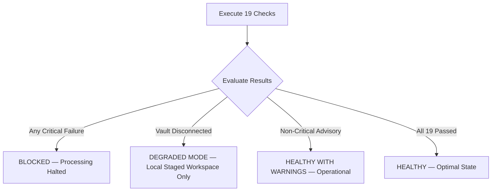

# PERCIVAL — Automatic Startup Health-Check System Reference

**Target Version:** PERCIVAL v5.25  
**Module:** `cSS_pipeline_v4.13/unified_engine/uengine/health.py`  
**API Endpoint:** `GET /api/health`  
**Execution:** Automatic on every launch & on-demand via GUI  

---

## 1. Overview & Architectural Role

The **Startup Health-Check System** runs on every PERCIVAL launch prior to main workspace activation. It executes **19 distinct automated health checks** covering build integrity, compute dependencies, storage topology, database consistency, transaction recovery journals, active model checkpoints, and shutdown cleanlines.

Results are categorized into 4 operational tiers, logged to an append-only JSONL audit ledger, and automatically perform non-destructive self-repair where possible.

---

## 2. The 19 Automated Health Checks

| # | Check Name | Verification Scope | Status Thresholds |
| :-: | :--- | :--- | :--- |
| **1** | **Version & Build Integrity** | Validates release version (v5.25) and manifest presence | Healthy / Warning |
| **2** | **Python Environment** | Validates Python 3.11+, PyTorch, Nibabel, Scikit-Learn, SciPy | Healthy / Warning (if optional package absent) |
| **3** | **FreeSurfer & License** | Verifies `$FREESURFER_HOME`, `license.txt`, `recon-all`, `mri_synthseg` | Healthy / Warning (SynthSeg-only mode available) |
| **4** | **Mac SSD Free Space** | Queries root APFS container disk usage | `> 50 GB`: Healthy<br>`20-50 GB`: Warning<br>`5-20 GB`: Critical<br>`< 5 GB`: **BLOCKED** |
| **5** | **Data Vault Mount & UUID** | Verifies external Data Vault mount status and matching UUID | Connected: Healthy<br>Disconnected: **DEGRADED MODE** |
| **6** | **External Storage Space** | Evaluates free space on external Data Vault | `> 20 GB`: Healthy<br>`< 10 GB`: Warning |
| **7** | **Directory Permissions** | Tests atomic write/delete access across workspace & app data | All writable: Healthy<br>Read-only: **BLOCKED** |
| **8** | **Pensieve Integrity** | Runs SQLite `PRAGMA integrity_check;` and verifies WAL mode | `ok`: Healthy<br>Corrupted: **BLOCKED** |
| **9** | **Recovery Journal** | Inspects `recovery_journal.json` for pending atomic transactions | Clean: Healthy<br>Pending: Warning (Auto-reconciles) |
| **10** | **Incomplete Outputs** | Detects orphaned `*.incomplete` or `*.part` files from crashes | Clean: Healthy<br>Found: Warning (Quarantined) |
| **11** | **Transfer Queue** | Checks `transfer_queue.json` for interrupted staging transfers | Synchronized: Healthy<br>Interrupted: Auto-resumed |
| **12** | **Job Ledger Consistency** | Validates patient processing status vs history | Consistent: Healthy<br>Running from crash: Auto-requeued |
| **13** | **Model Checkpoints** | Validates ALBUS, LUMOS, NOX, and Percival Core weights | Checksums verified: Healthy |
| **14** | **Feature Schema** | Verifies 86 anatomical/spatial feature contracts | Schema v5.25: Healthy |
| **15** | **Identity Vault Status** | Validates Standard mode password-free state & optional lock | Initialized: Healthy |
| **16** | **Backup Recency** | Evaluates timestamp of latest PENSIEVE snapshot | `< 14 days`: Healthy<br>`> 14 days`: Warning |
| **17** | **Stale File Locks** | Detects stale PID lockfiles from dead processes | Clean: Healthy<br>Stale locks: Auto-removed |
| **18** | **Unfinished Migrations** | Checks `migration_state.json` for paused background tasks | Complete: Healthy<br>In-progress: Warning |
| **19** | **Abnormal Shutdown** | Inspects clean shutdown sentinel `.clean_shutdown` | Clean: Healthy<br>Unclean exit: Warning |

---

## 3. Operational Classification Tiers



- **`HEALTHY`:** All 19 checks passed without warnings. Full production capabilities active.
- **`HEALTHY_WITH_WARNINGS`:** Non-critical notices (e.g. FreeSurfer not installed if using fast SynthSeg mode, backup > 14 days old, Mac SSD between 20-50 GB). Operational.
- **`DEGRADED_MODE`:** External Data Vault is disconnected or read-only. App operates fully on locally staged studies; external studies badged **ARCHIVED — DRIVE REQUIRED**.
- **`BLOCKED`:** Critical barrier preventing safe processing (Mac SSD < 5 GB, corrupted SQLite database, unreadable local workspace). Halts automated queues to prevent data damage.

---

## 4. Automated Safe Self-Repair

During launch, `StartupHealthCheck.run_all(auto_repair=True)` automatically executes:
1. **Rebuilds Missing Directories:** Creates empty `app_data/scratch/`, `staging/`, `logs/`, `identity/` if absent.
2. **Clears Stale PID Locks:** Validates whether the PID holding a lock is dead; if dead, removes the stale lockfile.
3. **Quarantines Orphaned Temp Files:** Purges temporary files (`*.tmp`) older than 24 hours.

## 5. Audit Logging

Every execution appends an entry to `app_data/health_history.jsonl`:
```json
{"timestamp": "2026-11-22T21:20:00Z", "status": "HEALTHY", "duration_ms": 42.1, "passed": 19, "warnings": 0, "degraded": 0, "blocked": 0, "repairs": 0}
```
Accessible via GUI in **Research › Percival Intelligence › Data Vault › Run Full System Health Check**.
