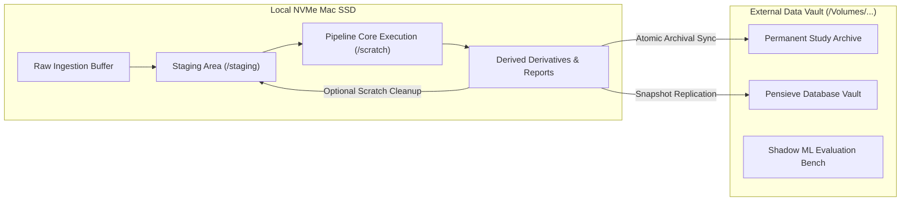
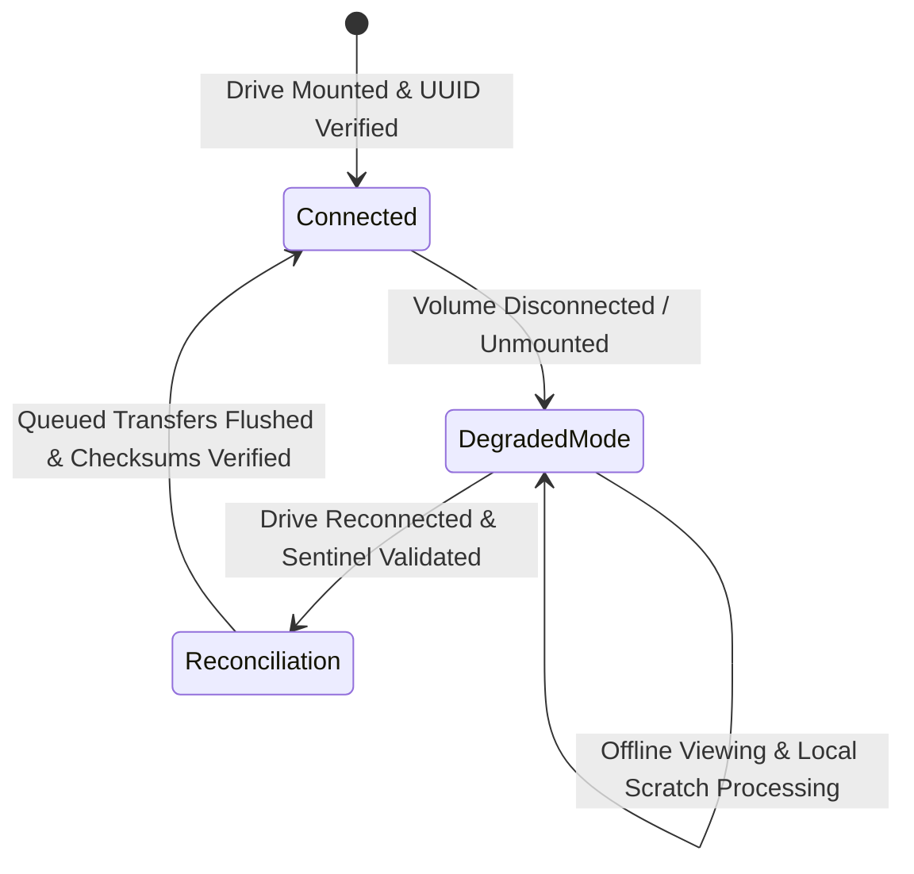
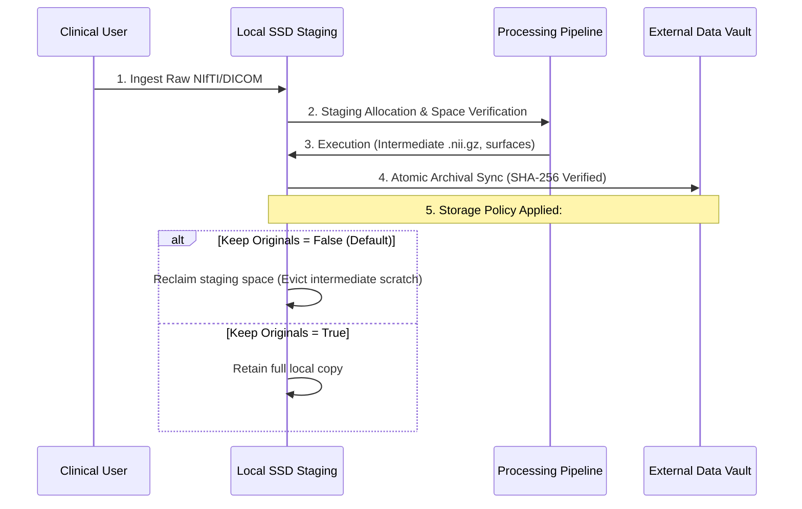

# PERCIVAL — Storage Topology & Data Vault Architectural Guide

**Target Version:** PERCIVAL v5.25  
**Platform:** macOS (Darwin arm64 / x86_64)  
**Modules:** `uengine/staging.py`, `uengine/vault.py`, `uengine/storage_advisor.py`, `uengine/file_manager.py`  

---

## 1. Executive Summary & Dual-Storage Architecture

PERCIVAL implements a high-throughput, fault-tolerant **Dual-Storage Topology** designed specifically for high-resolution 3D neuroimaging workloads on macOS systems. Clinical MRI datasets (T1w MPRAGE, T2* GRE, axial SWI/QSM) and FreeSurfer cortical reconstructions generate gigabytes of intermediate data per subject. Storing entire longitudinal cohorts directly on the primary internal Mac SSD rapidly exhausts internal storage, while running heavy iterative convolutional neural networks and deformation field estimations directly over external USB/Thunderbolt interfaces incurs significant I/O latency bottlenecks.

To resolve this conflict, PERCIVAL decouples pipeline execution from long-term archival:

1. **Local Fast SSD (Staging & Scratch Buffer):**  
   All active image transformations, brain skull-stripping, surface mesh generation, and deep feature extractions occur exclusively on high-speed internal NVMe storage (`percival_workspace/staging` and `percival_workspace/scratch`).
2. **External Data Vault (Long-Term Archival & Cohort Intelligence):**  
   Cold anatomical MRIs, finalized FreeSurfer segmentations, canonical Pensieve SQLite databases, audit trails, and immutable PDF/DICOM clinical reports are archived on an external high-capacity volume (`/Volumes/<VAULT_NAME>/PERCIVAL_VAULT`).



---

## 2. Hardware Binding: Volume UUID Identification

External storage devices mounted under `/Volumes` on macOS frequently suffer from dynamic mount-point renames (e.g., `/Volumes/ExtDrive 1`, `/Volumes/ExtDrive 2`) if drives are reconnected before unmount handles are released by the operating system.

To guarantee persistent drive identity across system reboots, sleep-wake cycles, and USB hub re-enumerations, PERCIVAL does not rely on transient path strings alone. Instead, it extracts and binds the persistent **Hardware Volume UUID**:

### Resolution Engine (`uengine/vault.py`)
1. **macOS `diskutil info` Parsing:**  
   Extracts `Volume UUID` directly from the Darwin CoreStorage / APFS / HFS+ volume metadata.
2. **Darwin IORegistry Fallback:**  
   If `diskutil` reports a non-standard device, PERCIVAL queries `IORegistryEntryCreateCFProperty` to obtain the disk UUID.
3. **Volume Sentinel Verification:**  
   A unique hidden token `.percival_vault_id` is created inside the root of the vault. During startup or file operations, PERCIVAL verifies both the OS volume UUID and the internal token before committing write transactions.

```python
# Hardware Volume UUID binding example
vault = DataVault(
    volume_name="T7_SHIELD",
    volume_uuid="3E84C0F2-721A-4D78-9B5A-17E45C1082AA",
    vault_rel_path="PERCIVAL_DATA_VAULT"
)
```

---

## 3. Disconnection Handling & Degraded Mode

When an external drive is abruptly disconnected, unmounted by macOS power management, or physically absent at application launch, PERCIVAL prevents application crashes, data corruption, or unhandled I/O exceptions through **Graceful Degraded Mode**:



### Operational Rules in Degraded Mode
- **Study Lifecycle State:** Studies residing exclusively on the external drive are badged as:
  ```
  ARCHIVED — DRIVE REQUIRED
  ```
  The File Manager marks their raw DICOM/NIfTI files as offline while serving cached diagnostic summaries, Pensieve memory records, and thumbnail slices from the local metadata cache.
- **Local Emergency Scratch Buffer:**  
   If a new study is imported or a re-analysis job is launched while the external Data Vault is offline, PERCIVAL routes all intermediate outputs to a localized emergency scratch buffer with an enforced strict quota (default: `10.0 GB`).
- **Transfer Queue Ledger:**  
   All pending file transfers, model checkpoint updates, and archival packages are recorded transactionally in:
   `percival_workspace/transfer_queue.jsonl`.
- **Automatic Reconnection & Reconciliation:**  
   Upon drive re-insertion, `TransferQueueManager.reconcile()` detects the volume UUID, verifies drive health, systematically drains the transfer queue with SHA-256 validation, and updates study lifecycle states to `SYNCHRONIZED`.

---

## 4. Dual-Storage Lifecycle & Staging Protocol

Every study processed by PERCIVAL progresses through a rigorous 5-stage data lifecycle:



### Lifecycle States
1. `LOCAL_ONLY`: Study exists only in the local workspace or staging directory.
2. `STAGED`: Study has been staged on the local NVMe drive and is primed or actively running through pipeline analysis.
3. `ARCHIVED`: Final analysis package, derivatives, and structured metadata have been safely written to the external Data Vault.
4. `SYNCHRONIZED`: Both local staging cache and external vault contain identical, cryptographically verified copies.
5. `ARCHIVED_DRIVE_REQUIRED`: Study is archived on the external vault, but the external physical drive is currently unmounted or disconnected.

---

## 5. Original MRI Retention & Safety Policies

In accordance with strict clinical data integrity guidelines:

> [!IMPORTANT]
> **Zero Raw Data Deletion Default:**  
> By default, `keep_local_originals = False` applies strictly to intermediate temporary working directories (`/scratch`). **PERCIVAL never deletes original imported user DICOM or NIfTI source files without explicit, multi-stage confirmation from the user.**

Configurable policy flags in `app_data/storage_config.json`:
- `keep_local_originals` (`bool`, default: `False`): When set to `False`, raw NIfTI staging copies are safely reclaimed *only after* an exact SHA-256 verified copy has been confirmed in the external Data Vault.
- `auto_archive_on_completion` (`bool`, default: `True`): Automatically moves finished study runs to the external vault once pipeline outputs pass clinical sanity checks.
- `emergency_scratch_quota_gb` (`float`, default: `10.0`): Maximum capacity permitted for offline processing before demanding drive connection.

---

## 6. Storage Advisor: Capacity Tiers & Pruning Rules

The **Storage Advisor** (`uengine/storage_advisor.py`) continuously monitors local Mac SSD headroom and external vault capacity, categorizing disk state into four standardized operational tiers:

| Capacity Tier | Local SSD Free Space | Operational Posture & Automated Behavior |
| :--- | :--- | :--- |
| **Healthy** | `> 50 GB` | Full multi-study pipeline concurrency permitted. Background telemetry active. |
| **Warning** | `20 GB - 50 GB` | Concurrency throttled to 1 study. Non-critical logs marked for pruning. Storage alert displayed in GUI. |
| **Critical** | `5 GB - 20 GB` | Background caching disabled. Staging requires explicit confirmation. Aggressive cleanup of stale scratch files. |
| **Emergency** | `< 5 GB` | Processing blocked. Read-only inspection enabled. Automatic emergency scratch eviction triggered. |

### Retention & Reclamation Rules
1. **7-Day Intermediate Scratch Pruning:**  
   Temporary working folders in `staging/` and `scratch/` older than 7 days that do not belong to active running jobs are automatically purged.
2. **14-Day Failed Run Archival:**  
   Crashed or aborted pipeline runs are preserved for 14 days with execution tracebacks before being archived or purged.
3. **30-Day Operational Log Rotation:**  
   Diagnostic server logs and health check logs are rotated, compressed, and truncated beyond 30 days.
4. **Pensieve SQLite Immortality:**  
   Pensieve database files (`pensieve_core.db`) and their backup snapshots are **strictly excluded** from automated deletion policies regardless of storage pressure.
