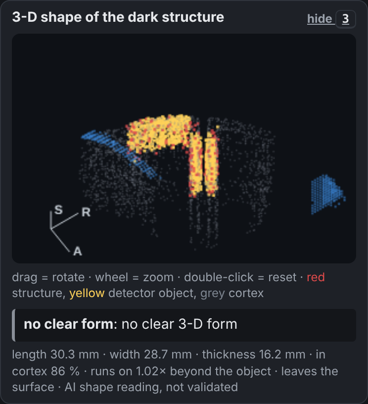

# 3-D candidate viewer: failure analysis (Part 1 audit, no code changed)

Branch `experimental/3d-morphology-viewer`. Audited code:
`scripts/review_web.py` `Study.struct3d()` (lines ~189-220, served at `/api/struct3d`),
`scripts/css_shape.py` (`dark_support`, `principal`, `struct_measures`, `classify3d`),
`scripts/review_web.html` (`s3Draw`, `s3Load`, `s3Bind`, card `#s3card`).

Before: PH6 phantom, candidate 1, a sulcal tram-track band, which is cSS by construction.

The viewer reported: length 30.3 mm, width 28.7 mm, thickness 16.2 mm, class OTHER, "no clear 3-D form".
A band about 1–3 mm thick was reported as 16 mm thick, and its tube-versus-sheet character was lost.

## Answers to the twelve audit questions

| # | Question | Finding |
|---|---|---|
| 1 | Background volume | None. The 3-D card shows no MRI intensity at all; it uses only binary maps. |
| 2 | Mask displayed | `core` = `Study.lab == cid`, the labelled candidate from `review/ID_candidates.nii.gz`. `struct` = the *regrown dark structure* (see 5). |
| 3 | Original or post-processed? | `core` is the original candidate label. `struct` is a post-processed, regrown support, and the measurements use `struct`, not the candidate. |
| 4 | All voxels or one component? | All voxels of the label, but **randomly subsampled**: at most 900 core points, 1800 structure points, 2200 cortex points and 500 other-candidate points (`pts_mm(..., cap, seed)`). |
| 5 | Nearby structures included? | **Yes, by design.** `dark_support` takes every 26-connected component of `work/ID_dark.nii.gz` touching the candidate (dilated by 1 voxel), clipped at **20 mm**. Neighbouring veins, a second sulcal bank and dark cortex are merged into the measured object. |
| 6 | Connected-component based? | Yes for the structure (26-connectivity in the dark map). The candidate's own components are never separated or shown. |
| 7 | Smoothing / interpolation / thresholding / meshing | No mesh and no smoothing. Thresholding is inherited from the binary dark map. Points are voxel centres drawn as 1.4–2.6 px squares. |
| 8 | Spacing and orientation | Respected. Volumes are loaded `as_closest_canonical` (RAS+), and points are converted to mm with `vox`. Correct. |
| 9 | Anisotropic voxels | Physically scaled, but each voxel is drawn as a single dot. On 0.8 × 0.8 × 1.2 mm (or 3 mm slice) data, slices show as separated layers of dots (visible as vertical striping). |
| 10 | Coordinate system | Canonical voxel grid → mm, centred on the structure's centroid (not the candidate's). |
| 11 | Mesh source | There is no mesh. A painter-sorted point cloud is drawn on a 2-D canvas. |
| 12 | Access to intensities / features | The server has the SWI (`Study.img`), labels, `pial_sd`, the dark map and the candidate CSV (Hessian `tube_ratio`, `tram_frac`, etc.), **but none of it reaches the viewer** except the four binary point sets and one summary dict. No per-voxel Hessian maps are stored by the detector. |

## Why it looks noisy and does not isolate the lesion

1. **Measured object ≠ candidate.** All shape numbers (s1/s2/s3, class, verdict) come from the 20 mm regrown dark support, not the candidate. On PH6 the support joins both banks of the sulcus plus the gyral crown, so its PCA extents become roughly 30 × 29 × 16 mm, which is an L-shaped slab. *Main cause.*
2. **One PCA for a bent object.** `principal()` uses the extents along global covariance axes. A curved or folded sheet (cSS follows the sulcus) has a large third extent because of its *bend*, not its *thickness*. PCA cannot tell a thick object from a thin, curved one. `thick` (2 × p90 EDT) is computed but not used for the class.
3. **Random subsampling.** Point caps throw away up to 90 % of voxels at random, which gives a speckled, sparse look, especially for cortex (2200 of tens of thousands).
4. **Point cloud, no surface.** Voxel centres are drawn as squares with only depth sorting. There is no shading and no occlusion of the far side, so thin sheets look like fog and veins look like dotted lines.
5. **Clutter layers.** A 14 mm cortex shell (grey) and *other candidates* (blue) are always on, and they compete visually with the candidate.
6. **Fixed camera and scale.** The scale fits the farthest point of any layer (capped at 26 mm), so a small candidate surrounded by cortex occupies a small fraction of the canvas.
7. **Classifier thresholds on bounding extents.** `classify3d` uses ratios of extents (TUBE_R, RIB_R, BALL_MM). It needs `s3 ≥ 1.5 × largest voxel`, so most real thin cSS on 2–3 mm slices returns UNRESOLVED or OTHER.
8. **No local information.** There are no cross-sections, no skeleton, no per-region tube or sheet evidence, so a candidate that is half vein and half cSS gets one global label.

Not found to be causes: wrong spacing, wrong orientation, wrong mask file, interpolation of the label (order 0 when grids differ).

## Consequence for the redesign

The new viewer must measure **the candidate itself**: its components; local thickness from a distance transform; cross-sections along a skeleton or principal path; and local Hessian sheet- or tube-likeness computed on the candidate's bounding box. The regrown structure becomes an optional context layer. A surface (marching cubes on a display copy) replaces the point cloud. Next step: technical design and interface mockup, for approval before code.
