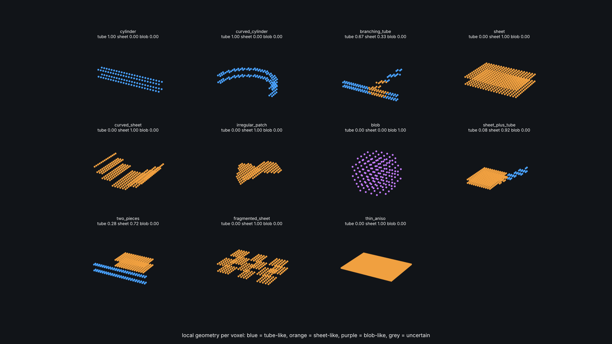
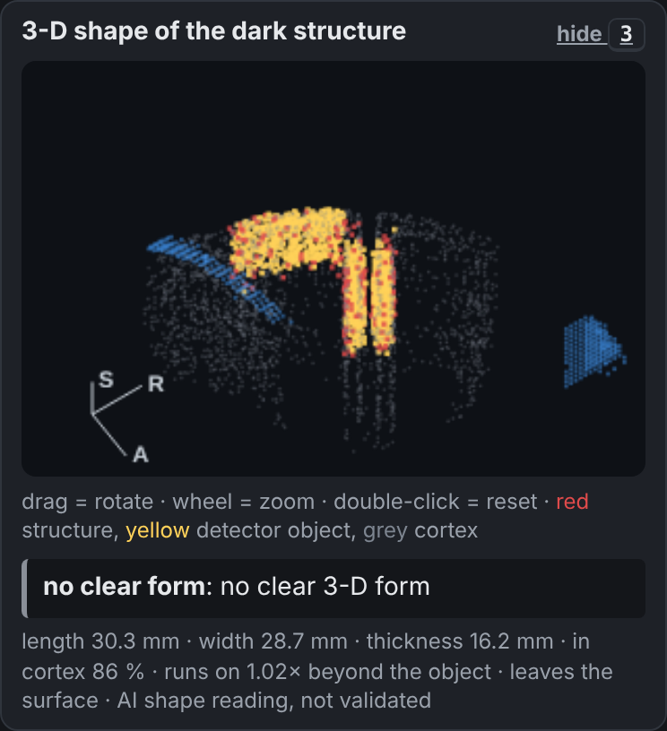
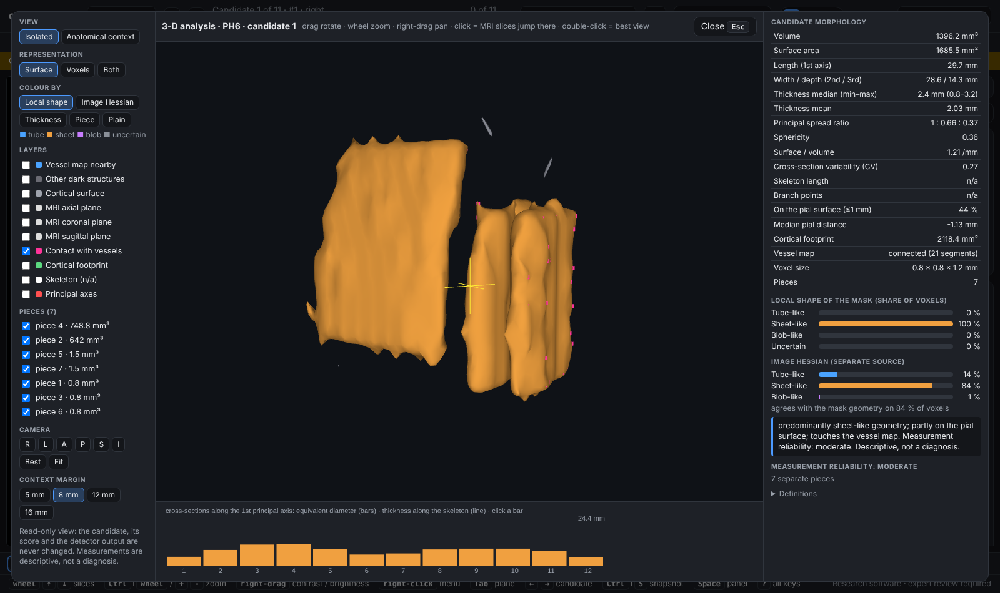

# 3-D morphology viewer: validation report

Run: `python tests/check_morph3d.py --report` (synthetic shapes) and `python tests/check_morph3d_api.py` (PH6 phantom
through the reviewer endpoint). Both pass. Numbers: `reports/morph3d_phantoms.csv`. Figure: `img/morph3d_phantoms.png`.
**Phantoms only. Nothing here has been checked on real patients yet** (that needs the user's Mac).

## 1. Synthetic shapes (drawn at 0.2 mm, averaged onto 0.8 × 0.8 × 1.2 mm voxels = partial volume)

| Shape | Tube | Sheet | Blob | Thickness (mm) | Sphericity | Skeleton | Result |
|---|---|---|---|---|---|---|---|
| straight cylinder r 1 mm | 1.00 | 0 | 0 | 1.6 (true 2.0) | 0.63 | yes, 19.2 mm (true 18 + caps) | tube, stable radius (CV ≤ 0.35) |
| curved cylinder | 1.00 | 0 | 0 | 1.6 | 0.54 | yes, follows the curve | tube |
| branching tube | 0.67 | 0.33 | 0 | 1.6 | 0.54 | yes | tube; the junction reads sheet-like (2-D spread) |
| flat sheet 1.2 mm | 0 | 1.00 | 0 | 2.4 | 0.60 | not forced | sheet (straddles two slices → 2 voxels thick) |
| curved sheet | 0 | 1.00 | 0 | 1.2 | 0.39 | not forced | sheet |
| irregular patch | 0 | 1.00 | 0 | 1.2 | 0.47 | not forced | sheet |
| compact blob r 3.5 mm | 0 | 0 | 1.00 | 4.8 | 0.97 | not forced | blob, never tube |
| sheet + tube | 0.08 | 0.92 | 0 | 2.4 | 0.59 | – | tube part found where it is (100 % of voxels beyond x 15 mm), sheet part ≥ 80 % sheet |
| two separate pieces | 0.28 | 0.72 | 0 | 2.4 | – | – | 2 pieces; one tube-like, one sheet-like |
| fragmented sheet | 0 | 1.00 | 0 | 2.4 | – | – | 6 pieces kept, all sheet-like |
| 2 mm sheet on 0.5 × 0.5 × 3 mm | 0 | 1.00 | 0 | 3.0 | – | – | sheet; reliability "moderate", anisotropy note |

Image Hessian (separate source): cylinder tube-like 1.00, curved sheet sheet-like 0.99; on the compact blob the Hessian reads
tube-like 0.81 (rim curvature at 0.8–1.6 mm), which is why it is shown as a separate overlay and not used as the shape class.

Display smoothing changes the mesh volume by ≤ 12 % on every shape (most 1–6 %). The input mask is never modified (checked).

### Anisotropy and orientation (cylinder r 1.2 mm, true volume 89 mm³, true length 20.4 mm)

| Voxels | Along x | Along z | Note |
|---|---|---|---|
| 1 × 1 × 1 | tube 1.00, 80 mm³ | tube 1.00, 80 mm³ | isotropic: same result in both orientations |
| 0.8 × 0.8 × 1.2 | tube 1.00, 74 mm³ | tube 1.00, 49 mm³ | |
| 0.5 × 0.5 × 2 | tube 0.89, 188 mm³ | tube 1.00, 152 mm³ | a 2.4 mm tube across 2 mm slices spans two slices: **volume ~2×** |

Shape class is stable across orientation and voxel size; **volume and thickness are not** on thick slices. The viewer says so
(reliability notes) rather than reporting false precision.

## 2. PH6 phantom through the reviewer (real detector candidates, truth known)

| Candidate | Truth | Tube | Sheet | In CSF | Reading |
|---|---|---|---|---|---|
| #1–#5 | cSS (tram-track bands, both sulcal banks) | 0 | 0.99–1.00 | 8–13 % | sheet-like, follows the cortex |
| #6 | tubular vein | 0.82 | 0 | – | tube-like |
| #7, #8 | surface-vein branches (1 voxel thin) | 0.47–0.52 | 0.40–0.43 | – | mixed (one-voxel lines are borderline) |
| #9 | flat vein lying in sulcal CSF | 0 | 1.00 | **93 %** | sheet-like **ribbon**: geometry alone cannot separate it; its position (pial distance +1.6 mm, 93 % in CSF) does |
| #10, #11 | surface-vein branches | 1.00 | 0 | – | tube-like |

The old 3-D card called candidate #1 (true cSS) "16 mm thick, no clear 3-D form" from the regrown 20 mm dark structure; the
new analysis measures the candidate itself: sheet-like 100 %, median thickness 2.4 mm.

## 3. Before / after (same candidate, PH6 #1)

| Before (old card) | After (isolated surface, local shape colours) |
|---|---|
|  |  |

Other views: `img/after_3d_PH6_c1_voxels.png` (exact voxels), `img/after_3d_PH6_c1_context.png` (vessel map, cortex,
MRI plane), `img/after_3d_PH6_c6_vein.png` (vein #6, tube-like), `img/after_3d_PH6_c8_mixed.png` (thin branch, mixed).
Interaction checked in headless Chromium (WebGL via SwiftShader): a click on the 3-D candidate moved the MRI cursor
(107,27,48 → 109,26,49); a cross-section click highlighted its slab (4,784 pixels); no page errors.

## 4. Acceptance criteria

| # | Criterion | Status |
|---|---|---|
| 1 | candidate isolated | yes: the candidate label only; context is optional layers |
| 2 | original mask accessible | yes: "Voxels" view, every voxel sent |
| 3 | spacing / orientation | yes: canonical RAS+, per-axis voxel size, R L A P S I presets |
| 4 | surface faithful | yes: marching cubes on the mask; smoothing volume change reported (≤ 12 %) |
| 5 | inspect without clutter | yes: Isolated mode |
| 6 | length / width / thickness / volume in mm | yes |
| 7 | local cross-sections | yes: strip + highlighted slab |
| 8 | tube vs sheet quantified | yes: per-voxel classes and shares |
| 9 | Hessian separate | yes: own section and own colour mode |
| 10 | mixed structures | yes: per-voxel classes (sheet + tube phantom) |
| 11 | vessel layer independent | yes |
| 12 | 3-D ↔ MRI sync | yes (click → slices; slices → yellow cross) |
| 13 | synthetic shapes sensible | yes (table 1) |
| 14 | detection unchanged | yes: no detector / scoring file changed; PH6 files byte-identical after the analysis |

## 5. Not done / limits

- Not run on real patients (P006, M-cohort): needs the user's Mac. Real thin cSS on 2–3 mm slices will often read
  "reliability moderate/low".
- Cross-sections follow the first principal axis (oblique for strongly curved objects); the skeleton is shown only for curve-like objects.
- Geodesic length / width on the cortical surface (recon-all surfaces) is not part of this view (surface_features.py has it for recon-all cases).
- The local-shape thresholds are geometric constants checked on phantoms, not fitted to labelled real data.
